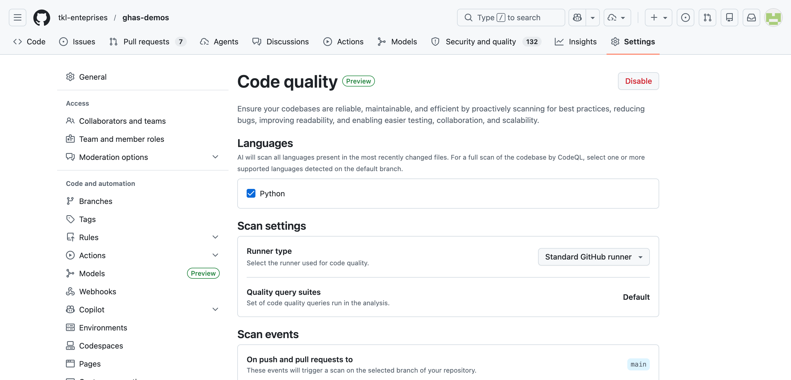
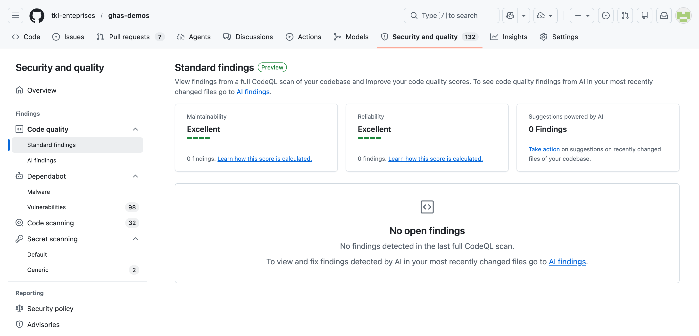

# Lesson 06 — Code Quality Standard findings

> **Status (verified November 2026):** GitHub Code Quality has been **generally available since July 20, 2026** on GitHub Team and GitHub Enterprise Cloud (not GitHub Enterprise Server). The AI findings in lesson 07 are still a public preview. Recheck billing before a customer delivery.

GitHub Code Quality is separate from GitHub Code Security, although its rule-based Standard findings use CodeQL and appear under **Security and quality**.

## Goal

Show how deterministic CodeQL quality rules identify reliability and maintainability issues, surface findings on the default branch and pull requests, and support ruleset enforcement.

## Learning objectives

After this lesson you can:

- Distinguish Code Quality from Code Security.
- Explain how CodeQL-powered Standard findings differ from AI findings.
- Interpret reliability and maintainability scores.
- Review a pull-request quality comment and Autofix suggestion.
- Explain how quality and coverage rulesets can block a merge.

## Estimated time

**~15 min demo + 5 min discussion**

## Prerequisites

- GitHub Code Quality is enabled for this organization-owned repository.
- GitHub Actions is enabled; CodeQL quality analysis runs in a dynamic **Code Quality** workflow.
- A GitHub-hosted or appropriately labeled self-hosted runner is available.
- Node.js is optional and used only to check the inert JavaScript fixture locally.

[Lesson 01 — CodeQL Code Scanning](../01-code-security-codeql-scanning/) provides a useful comparison, but Code Security is not a license dependency for Code Quality.

## Product and licensing

| Area | Current documentation (November 2026) |
|---|---|
| Product status | Generally available since July 20, 2026; AI findings (lesson 07) remain in public preview |
| Plans | GitHub Team and GitHub Enterprise Cloud; not GitHub Enterprise Server |
| Repository scope | Organization-owned repositories; organization-wide enablement and organization-level score dashboards arrived at GA |
| Code Security license | Not required; Code Quality is a standalone product that doesn't consume GitHub Advanced Security licenses |
| Copilot license | Not required for Code Quality, its AI-assisted detection, or its Autofix suggestions |
| Pricing | $10 per active committer per month (anyone who pushed to a Code Quality-enabled repository in the last 90 days, counted once per organization; bot accounts are free), plus usage-based AI credits for AI-assisted detection and Autofix, plus GitHub Actions minutes for the CodeQL analysis |

## Demo assets and expected findings

[`quality-fixtures.js`](quality-fixtures.js) exports two functions without calling them or performing I/O.

| Expected rule ID | Category | Severity | Precision | Intentional defect |
|---|---|---|---|---|
| [`js/template-syntax-in-string-literal`](https://codeql.github.com/codeql-query-help/javascript/js-template-syntax-in-string-literal/) | Reliability | Warning | High | Ordinary quotes leave `${userName}` uninterpreted. |
| [`js/useless-assignment-to-local`](https://codeql.github.com/codeql-query-help/javascript/js-useless-assignment-to-local/) | Maintainability | Warning | Very high | The initial `tasks.length` value is overwritten before it is read. |

These are deterministic Standard findings. With only these two results, the Reliability and Maintainability scores should both be **Fair**, because Warning is the worst severity in each category.

## Scores

GitHub's docs call these **scores** (earlier preview material said *ratings*).

| Score | Worst finding present |
|---|---|
| **Excellent** | No quality findings |
| **Good** | Note |
| **Fair** | Warning |
| **Poor** | Error |

Scores summarize rule-based CodeQL results on the full default branch. They do not include AI findings or code coverage.

## Walkthrough

1. **Inspect the fixture.** Open [`quality-fixtures.js`](quality-fixtures.js) and confirm it is inert.

   ```bash
   node --check quality-fixtures.js
   ```

2. **Confirm enablement.** Open repository **Settings → Code quality** and review enabled languages and runner choice.

   

3. **Review Standard findings.** Open **Security and quality → Code quality → Standard findings**. Locate the two expected rule IDs, expand each rule, and follow the result to `quality-fixtures.js`.

   

4. **Review pull-request feedback.** Introduce the fixture through a temporary branch or apply the remediation from [`solution.md`](solution.md). In the PR, find **CodeQL - Code Quality / Analyze** and inspect any `github-code-quality[bot]` comments and Autofix suggestions.

5. **Compare with Code Security.** Open **Code scanning**. Both experiences can use CodeQL, but this lesson runs reliability and maintainability rules under the separately licensed Code Quality product.

6. **Inspect enforcement.** Open **Settings → Rules → Rulesets**. Review **Require code quality results** and **Restrict code coverage** without enabling them on the shared workshop repository. Since GA, quality gates support coverage thresholds and an **evaluate** mode for a gradual rollout.

## Optional code coverage discussion

Code Quality accepts Cobertura XML reports and, since GA, renders coverage metrics directly on pull requests, but it does not run tests for you. A workflow needs `code-quality: write`, should upload a baseline from the default branch, and should guard privileged uploads from untrusted forks. Coverage thresholds and quality-severity thresholds are separate ruleset controls.

## Exit criteria

The demo has landed when attendees can:

- Locate the two deterministic Standard findings.
- Explain why the scores are Fair.
- Distinguish Standard findings from the post-merge AI analysis in lesson 07.
- Describe PR feedback, Autofix, and ruleset enforcement.

## Key takeaways

- **Separate product, shared engine:** Code Quality uses CodeQL but is licensed independently from Code Security.
- **Deterministic analysis:** Standard findings come from named, tested rules.
- **PR and default-branch coverage:** the same rule-based analysis supports review feedback and repository scores.
- **Enforcement is configurable:** rulesets can gate on quality severity and coverage.

## Discussion questions

1. Which quality severity should block new pull requests?
2. What does an **Excellent** score prove, and what does it not prove?
3. How should teams validate an Autofix before merging it?
4. Should coverage percentage, coverage drop, or both be enforced?

## Reset state

Do not merge the remediation if the repository should retain stable demo findings. Close temporary PRs and delete only their workshop branches. Leave `quality-fixtures.js` unchanged on the default branch.

## Official references

- [About GitHub Code Quality](https://docs.github.com/en/code-security/code-quality/concepts/about-code-quality)
- [CodeQL-powered analysis for Code Quality](https://docs.github.com/en/code-security/code-quality/reference/codeql-detection)
- [JavaScript CodeQL queries for Code Quality](https://docs.github.com/en/code-security/code-quality/reference/codeql-queries/javascript-queries)
- [Metrics and scores reference](https://docs.github.com/en/code-security/code-quality/reference/metrics-and-ratings)
- [Code Quality general availability (changelog, 2026-07-20)](https://github.blog/changelog/2026-07-20-github-code-quality-is-now-generally-available/)
